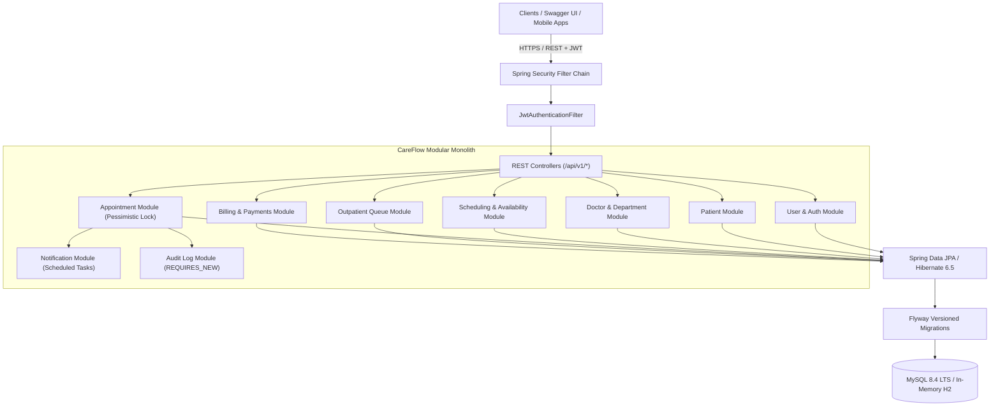
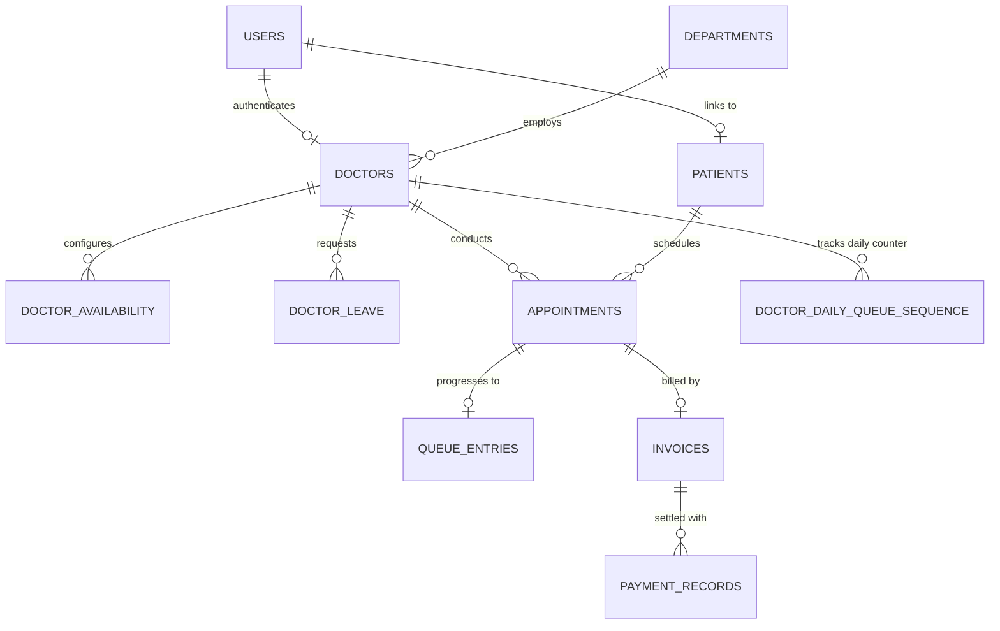

# CareFlow — Hospital Operations & Appointment Scheduling System


CareFlow is a production-grade, modular monolith Java backend built with **Spring Boot 3.3.4** and **Java 21 LTS**. It manages real-world hospital workflows: patient onboarding, doctor clinical schedules, real-time appointment booking with **database-backed pessimistic concurrency protection**, outpatient queue progression, consultation billing, and scheduled reminders.

Designed as an engineering portfolio project, CareFlow demonstrates practical transaction isolation, race-condition mitigation, state machines, automated integration testing, and clean architecture.

---

## 1. Core Features

- **Role-Based Access Control (RBAC):** `ADMIN`, `DOCTOR`, `RECEPTIONIST`, and `PATIENT` roles enforced with Spring Security and HMAC-SHA256 JWT tokens.
- **Doctor Availability & Schedule Engine:** Real-time computation of non-conflicting 30-minute appointment slots based on recurring working hours, approved leaves, and booked intervals.
- **Pessimistic Concurrency Protection:** Eliminates appointment double bookings under concurrent requests using `SELECT ... FOR UPDATE` row-level locks on the `Doctor` record.
- **Strict Appointment State Machine:** Validates allowed status transitions (`BOOKED` -> `CHECKED_IN` -> `IN_CONSULTATION` -> `COMPLETED`, `BOOKED` -> `CANCELLED`, `BOOKED` -> `NO_SHOW`).
- **Atomic Outpatient Queue Numbering:** Allocates gapless, collision-free sequential queue numbers (`1, 2, 3...`) using dedicated daily sequence counters and synchronized transactions.
- **Server-Side Financial Billing:** Calculates consultation fees strictly from server-side doctor rates (never trusting frontend data) and records simulated payment settlements.
- **Automated Reminders & Scheduling:** Background `@Scheduled` tasks scanning upcoming 24-hour appointments and dispatching email notifications.
- **Centralized Exception Handling:** Standardized `ApiResponse<T>` and `ErrorResponse` formats across all endpoints with zero sensitive stack traces leaked to clients.
- **Interactive API Documentation:** Full OpenAPI 3 specification accessible via Swagger UI.

---

## 2. Technology Stack

- **Runtime & Language:** Java 21 LTS
- **Framework:** Spring Boot 3.3.4 (Spring MVC, Spring Data JPA, Spring Security, Spring Validation, Spring Scheduler)
- **Database:** MySQL 8.4 LTS (Production & Docker) / In-Memory H2 in MySQL Compatibility Mode (Local Dev & Unit/Integration Tests)
- **Database Migrations:** Flyway (7 versioned migration scripts `V1__` through `V7__`)
- **Authentication:** Stateless JWT (`jjwt-api:0.12.6`, `jjwt-impl`, `jjwt-jackson`)
- **API Documentation:** Springdoc OpenAPI 2.6.0 / Swagger UI
- **Build Tool:** Apache Maven 3.9+
- **Testing:** JUnit 5 Jupiter, Mockito, Spring Boot Test, MockMvc, AssertJ, Testcontainers (MySQL 8.4)
- **Containerization:** Docker & Docker Compose with multi-stage build

---

## 3. Architecture & Data Model

### Architecture Diagram


### Database ER Diagram


---

## 4. Quickstart & Installation

### Prerequisites
- **Java 21 LTS** installed (`java -version`)
- **Maven 3.9+** installed (`mvn -v`)
- *(Optional)* **Docker & Docker Compose** for running containerized MySQL 8.4

### 4.1 Running Locally with In-Memory Database (Default Profile: `dev`)
CareFlow is pre-configured to run out of the box using in-memory H2 in MySQL mode, executing all 7 Flyway migrations and seeding synthetic data automatically:

```bash
# Clone the repository
git clone https://github.com/your-username/CareFlow.git
cd CareFlow/backend

# Build and run the Spring Boot application
mvn clean spring-boot:run
```
The server will start on port `8080`.
- **Swagger UI:** `http://localhost:8080/swagger-ui.html`
- **OpenAPI JSON Docs:** `http://localhost:8080/v3/api-docs`

### 4.2 Running with MySQL 8.4 via Docker Compose
To run both MySQL 8.4 LTS and the CareFlow backend containerized:

```bash
# From the root directory (CareFlow/)
docker compose up --build -d
```
Docker will provision the MySQL container, wait for the health check to pass (`service_healthy`), and launch the backend application.

---

## 5. Seed Accounts & Credentials

The database migration `V7__seed_synthetic_data.sql` and `DataInitializer` pre-seed the following accounts for immediate testing. All seeded accounts use the password: `password123`.

| Email | Role | Associated Profile |
|---|---|---|
| `admin@careflow.com` | `ADMIN` | System Administrator |
| `receptionist@careflow.com` | `RECEPTIONIST` | Reception Desk Staff |
| `dr.smith@careflow.com` | `DOCTOR` | Dr. John Smith (Cardiologist, $75 fee) |
| `dr.jones@careflow.com` | `DOCTOR` | Dr. Sarah Jones (Dermatologist, $60 fee) |
| `dr.patel@careflow.com` | `DOCTOR` | Dr. Rajesh Patel (Internal Medicine, $50 fee) |
| `patient.alice@careflow.com` | `PATIENT` | Alice Walker (`PAT-2026-0001`) |
| `patient.bob@careflow.com` | `PATIENT` | Bob Davis (`PAT-2026-0002`) |

---

## 6. Running Automated Tests

CareFlow features unit tests, Spring WebMvc integration tests, and multi-threaded database concurrency tests:

```bash
cd backend

# Run all 24 unit, integration, and concurrency tests
mvn test

# Run specific concurrency tests
mvn test -Dtest=AppointmentBookingConcurrencyTest

# Run unit tests only
mvn test -Dtest=DoctorScheduleServiceTest,AppointmentValidationAndStateTest,QueueProgressionTest,BillingCalculationTest
```

### Test Suite Summary
- **24 tests executed, 0 failures, 0 errors.**
- **`AppointmentBookingConcurrencyTest`:** Verifies that concurrent threads attempting to book the exact same slot result in exactly 1 success and 1 conflict (`409 Conflict`).
- **`AppointmentBookingConcurrencyTest` (Queue):** Verifies that concurrent check-ins allocate strictly sequential, non-colliding queue numbers (`1, 2...`).

---

## 7. Sample API Usage (cURL)

### 7.1 Login & Obtain JWT Token
```bash
curl -X POST http://localhost:8080/api/v1/auth/login \
  -H "Content-Type: application/json" \
  -d '{"email":"patient.alice@careflow.com","password":"password123"}'
```

### 7.2 Query Available Appointment Slots
```bash
curl -X GET "http://localhost:8080/api/v1/appointments/available-slots?doctorId=1&date=2026-11-09" \
  -H "Authorization: Bearer <TOKEN>"
```

### 7.3 Book an Appointment
```bash
curl -X POST http://localhost:8080/api/v1/appointments \
  -H "Authorization: Bearer <TOKEN>" \
  -H "Content-Type: application/json" \
  -d '{
    "patientId": 1,
    "doctorId": 1,
    "startDateTime": "2026-11-09T09:00:00",
    "endDateTime": "2026-11-09T09:30:00",
    "reasonForVisit": "Cardiovascular consultation"
  }'
```

### 7.4 Check-In to Outpatient Queue
```bash
curl -X POST http://localhost:8080/api/v1/queue/check-in \
  -H "Authorization: Bearer <RECEPTIONIST_TOKEN>" \
  -H "Content-Type: application/json" \
  -d '{"appointmentId": 1}'
```

### 7.5 Generate and Settle Invoice
```bash
# Generate Invoice (consultation fee $75.00 automatically computed)
curl -X POST http://localhost:8080/api/v1/invoices/generate/1 \
  -H "Authorization: Bearer <RECEPTIONIST_TOKEN>"

# Pay Invoice
curl -X POST http://localhost:8080/api/v1/invoices/1/payments \
  -H "Authorization: Bearer <TOKEN>" \
  -H "Content-Type: application/json" \
  -d '{"method":"CREDIT_CARD"}'
```

---

## 8. Detailed Documentation Index

For in-depth explanations and technical documentation, refer to the `docs/` directory:

- [System Architecture (`docs/ARCHITECTURE.md`)](file:///d:/CareFlow/docs/ARCHITECTURE.md): Component interactions, security filter chain, and state machine diagrams.
- [Database Specifications (`docs/DATABASE.md`)](file:///d:/CareFlow/docs/DATABASE.md): Table definitions, indexing strategy, and Flyway migration guide.
- [Appointment Concurrency Deep-Dive (`docs/APPOINTMENT_CONCURRENCY.md`)](file:///d:/CareFlow/docs/APPOINTMENT_CONCURRENCY.md): Mathematical interval checks, pessimistic write locks, and concurrency test results.
- [REST API Reference (`docs/API.md`)](file:///d:/CareFlow/docs/API.md): Full endpoint catalog with JSON request/response payloads.
- [Technical Interview Guide (`docs/INTERVIEW_GUIDE.md`)](file:///d:/CareFlow/docs/INTERVIEW_GUIDE.md): Architectural decisions, Spring transaction mechanics, 15+ Q&A interview preparation items, and scaling strategies.

---

## 9. Known Limitations & Future Roadmap

1. **Doctor-Level Concurrency Bottleneck:**
   - *Current Implementation:* Exclusive locks are held on the `Doctor` row during appointment booking.
   - *Impact:* Guarantees 100% double-booking elimination, but serializes concurrent bookings for the *same* doctor across different dates.
   - *Future Enhancement:* Pre-materialize discrete appointment slots into a `doctor_slots` table with unique constraint `(doctor_id, slot_date_time)` or use Redis distributed locking (`Redlock`).
2. **Notification Transport:**
   - *Current Implementation:* Logs and records email dispatches into the database table `notifications`.
   - *Future Enhancement:* Configure external SMTP provider (AWS SES / SendGrid) or publish domain events (`AppointmentBookedEvent`) to an Apache Kafka cluster with dead-letter queue (DLQ) retry consumers.
3. **Payments Integration:**
   - *Current Implementation:* Simulates financial settlements (`CASH`, `CREDIT_CARD`, `SIMULATED_ONLINE`, `INSURANCE`) with idempotent payment recording. Real financial payment gateways (Stripe / Razorpay) are omitted by design for security.

---

## 10. License

This project is licensed under the Apache License 2.0.
