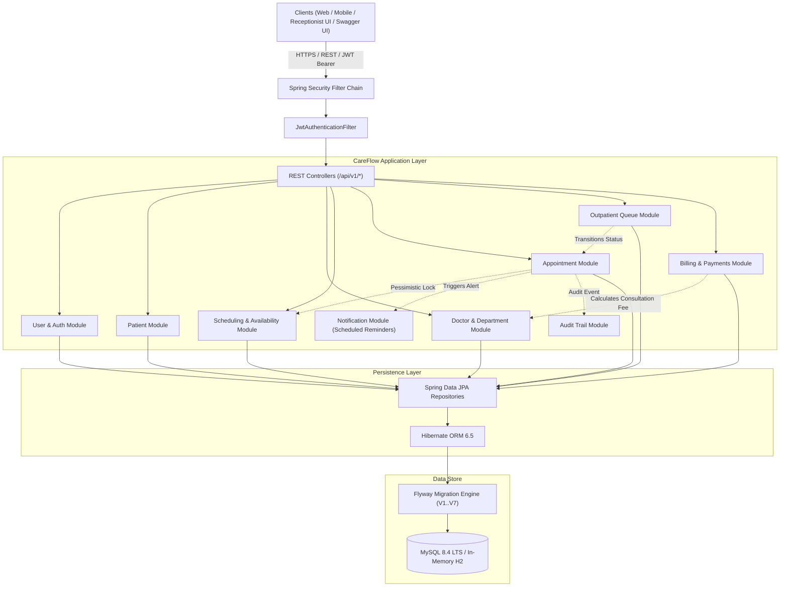
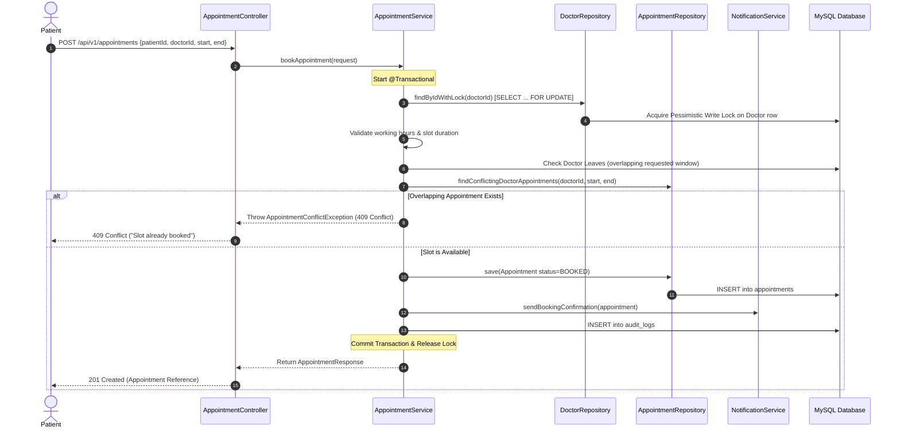
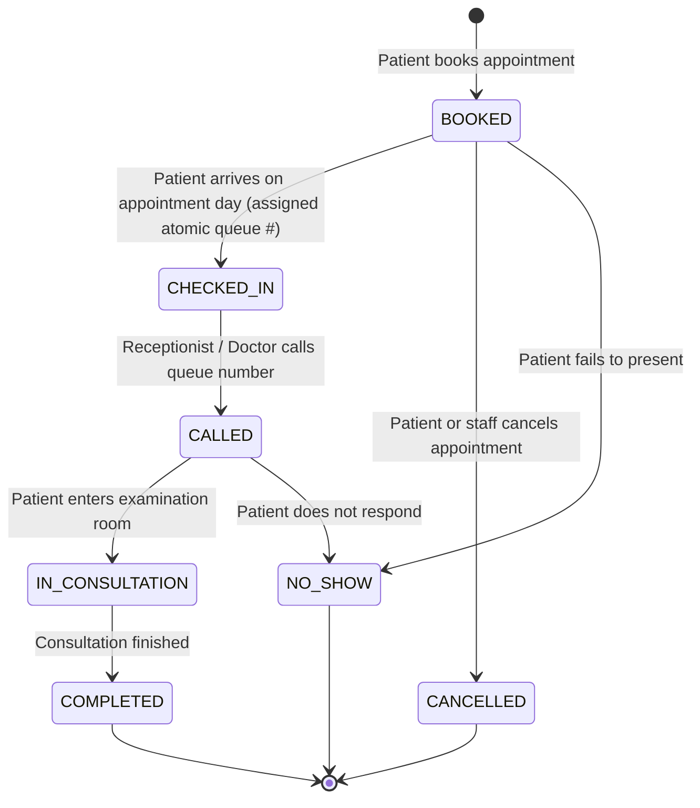

# CareFlow — System Architecture & Design Documentation

CareFlow is designed as a **Modular Monolith** backend application built with **Java 21 LTS** and **Spring Boot 3.3.4**. It manages core hospital workflows: patient registration, doctor schedules, real-time appointment booking, concurrent slot protection, outpatient queue progression, and billing.

---

## 1. High-Level Architectural Diagram

---

## 2. Package Responsibilities

The codebase follows strict package-by-feature modular monolith organization:

| Package | Responsibility |
|---|---|
| `com.careflow.common` | Shared infrastructure: generic `ApiResponse<T>`, `PagedResponse<T>`, domain exceptions, and global centralized `@RestControllerAdvice`. |
| `com.careflow.config` | Application-level beans: `OpenApiConfig` (Swagger 3), `DataInitializer` (credential synchronization). |
| `com.careflow.security` | Stateless security: `JwtTokenProvider`, `JwtAuthenticationFilter`, `CustomUserPrincipal`, `CustomUserDetailsService`, and `SecurityConfig`. |
| `com.careflow.user` | Authentication, password encryption, registration, role definitions (`ADMIN`, `DOCTOR`, `RECEPTIONIST`, `PATIENT`), and current user profile. |
| `com.careflow.patient` | Patient clinical demographic records, reference generation (`PAT-YYYY-XXXX`), and patient-level ownership access checks. |
| `com.careflow.department` | Hospital department directory, status toggling, and specialty management. |
| `com.careflow.doctor` | Doctor professional records, specialization mapping, consultation fee rates, and pessimistic lock entry points. |
| `com.careflow.scheduling` | Recurring weekly availability rules, doctor leave/vacation schedules, and real-time slot generation algorithms. |
| `com.careflow.appointment` | Core appointment engine: booking transactions, interval overlap detection, state machine, rescheduling, and cancellation policies. |
| `com.careflow.queue` | Outpatient daily queue management, atomic sequence generation (`doctor_daily_queue_sequence`), and consultation progression. |
| `com.careflow.billing` | Financial accounting: server-side consultation fee derivation, invoice generation, and simulated payment transactions. |
| `com.careflow.notification` | Communication engine: booking confirmations, cancellation alerts, rescheduling notices, and hourly background reminder tasks (`@Scheduled`). |
| `com.careflow.audit` | Compliance logging: asynchronous/isolated recording (`REQUIRES_NEW`) of sensitive operational events. |

---

## 3. Application Layers & Principles

### 3.1 DTOs and Data Immutability
- **Java 21 Records:** Request payloads (`BookAppointmentRequest`, `CreatePatientRequest`, `ProcessPaymentRequest`) and responses (`AppointmentResponse`, `InvoiceResponse`) are defined as immutable Java 21 `record`s.
- **Entity Encapsulation:** JPA entities are never returned directly from controllers. This prevents accidental lazy-loading serialization errors (`LazyInitializationException`) and avoids exposing database internals.

### 3.2 Explicit Transaction Boundaries
- All state-altering operations use explicit `@Transactional` annotations.
- Hotspot methods like `bookAppointment` and `checkIn` specify `@Transactional(isolation = Isolation.READ_COMMITTED)`.
- Audit logging uses `@Transactional(propagation = Propagation.REQUIRES_NEW)` to ensure audit logs persist even if an outer business transaction aborts.

### 3.3 Security & Role-Based Access Control (RBAC)
- All requests pass through `JwtAuthenticationFilter`, which parses HMAC-SHA256 bearer tokens.
- Method-level security is enforced via `@PreAuthorize("hasRole('ADMIN')")` or `@PreAuthorize("hasAnyRole(...)")`.
- Ownership verification ensures patients only access their own appointments, invoices, and medical data.

---

## 4. Key Workflows

### 4.1 Real-Time Appointment Booking Workflow

### 4.2 Outpatient Queue Progression Workflow

