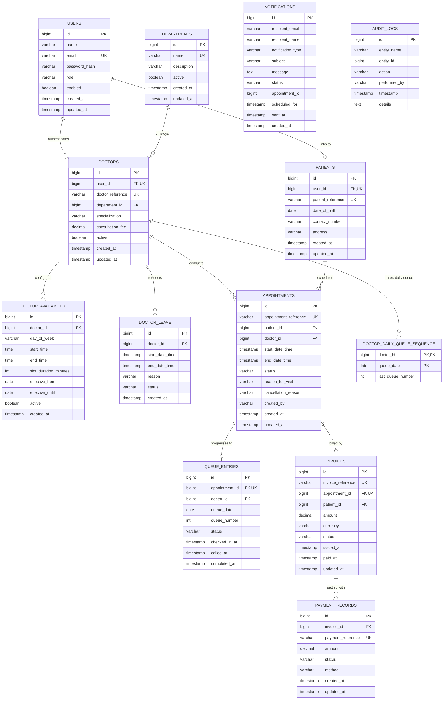

# CareFlow — Database Design & Schema Documentation

The CareFlow data layer uses a normalized relational schema managed with versioned **Flyway** migrations. It supports both **MySQL 8.4 LTS** in production and containerized environments, and **In-Memory H2** in MySQL compatibility mode for rapid unit and integration testing.

---

## 1. Entity-Relationship (ER) Diagram

---

## 2. Table Specifications & Indexes

### 2.1 `users`
- **Primary Key:** `id` (BIGINT AUTO_INCREMENT)
- **Unique Constraints:** `email` (VARCHAR 150)
- **Indexes:**
  - `idx_users_email` ON `users(email)`: Rapid authentication lookup.
  - `idx_users_role` ON `users(role)`: Filtering users by authority.

### 2.2 `departments`
- **Primary Key:** `id` (BIGINT AUTO_INCREMENT)
- **Unique Constraints:** `name` (VARCHAR 100)

### 2.3 `doctors`
- **Primary Key:** `id` (BIGINT AUTO_INCREMENT)
- **Foreign Keys:**
  - `user_id` REFERENCES `users(id)` ON DELETE CASCADE
  - `department_id` REFERENCES `departments(id)`
- **Unique Constraints:** `user_id`, `doctor_reference`
- **Indexes:**
  - `idx_doctors_department` ON `doctors(department_id)`
  - `idx_doctors_specialization` ON `doctors(specialization)`

### 2.4 `patients`
- **Primary Key:** `id` (BIGINT AUTO_INCREMENT)
- **Foreign Keys:**
  - `user_id` REFERENCES `users(id)` ON DELETE SET NULL (allows walk-in patient records without login accounts)
- **Unique Constraints:** `patient_reference`

### 2.5 `doctor_availability`
- **Primary Key:** `id` (BIGINT AUTO_INCREMENT)
- **Foreign Keys:** `doctor_id` REFERENCES `doctors(id)` ON DELETE CASCADE
- **Indexes:**
  - `idx_doc_avail_doctor` ON `doctor_availability(doctor_id)`
  - `idx_doc_avail_day` ON `doctor_availability(day_of_week)`

### 2.6 `doctor_leave`
- **Primary Key:** `id` (BIGINT AUTO_INCREMENT)
- **Foreign Keys:** `doctor_id` REFERENCES `doctors(id)` ON DELETE CASCADE
- **Indexes:**
  - `idx_doc_leave_interval` ON `doctor_leave(doctor_id, start_date_time, end_date_time)`: Optimizes overlap detection queries.

### 2.7 `appointments`
- **Primary Key:** `id` (BIGINT AUTO_INCREMENT)
- **Unique Constraints:** `appointment_reference`
- **Foreign Keys:**
  - `patient_id` REFERENCES `patients(id)`
  - `doctor_id` REFERENCES `doctors(id)`
- **Indexes:**
  - `idx_appt_doc_dates` ON `appointments(doctor_id, start_date_time, end_date_time, status)`: Hotspot index for conflict evaluation.
  - `idx_appt_patient` ON `appointments(patient_id, status)`: Rapid patient history lookup and patient double-booking check.
  - `idx_appt_status` ON `appointments(status)`: Status transition and reminder scanning.

### 2.8 `queue_entries`
- **Primary Key:** `id` (BIGINT AUTO_INCREMENT)
- **Unique Constraints:**
  - `appointment_id`: One queue entry per appointment.
  - `uk_queue_doctor_date_num` ON `(doctor_id, queue_date, queue_number)`: Strict uniqueness of queue positions per doctor per day.
- **Foreign Keys:**
  - `appointment_id` REFERENCES `appointments(id)` ON DELETE CASCADE
  - `doctor_id` REFERENCES `doctors(id)`

### 2.9 `doctor_daily_queue_sequence`
- **Primary Key:** `(doctor_id, queue_date)`
- **Foreign Keys:** `doctor_id` REFERENCES `doctors(id)` ON DELETE CASCADE
- **Purpose:** Used with pessimistic write locking to atomically increment and allocate sequential queue numbers without table scans or collision errors.

### 2.10 `invoices` & `payment_records`
- **Primary Key:** `id` (BIGINT AUTO_INCREMENT)
- **Unique Constraints:**
  - `invoice_reference` on `invoices`
  - `appointment_id` on `invoices`: Guarantees exactly one invoice per appointment.
  - `payment_reference` on `payment_records`
- **Foreign Keys:**
  - `appointment_id` REFERENCES `appointments(id)`
  - `patient_id` REFERENCES `patients(id)`
  - `invoice_id` REFERENCES `invoices(id)`

---

## 3. Flyway Migration Versioning

CareFlow uses Flyway migrations stored in `src/main/resources/db/migration`:

1. `V1__create_users_and_departments.sql`: Users table with BCrypt hash storage, roles, and hospital departments.
2. `V2__create_patients_and_doctors.sql`: Clinical doctor profiles, consultation pricing, and patient demographics.
3. `V3__create_doctor_availability_and_leave.sql`: Weekly recurring availability schedules and doctor leave intervals.
4. `V4__create_appointments_and_queue.sql`: Clinical appointments and outpatient queue table with composite uniqueness constraint.
5. `V5__create_billing_and_notifications.sql`: Consultation invoices, simulated payment logs, and notification dispatch records.
6. `V6__create_audit_and_queue_counter.sql`: Comprehensive audit logging and atomic daily queue sequence counter.
7. `V7__seed_synthetic_data.sql`: Seed data for development and testing: 7 accounts (admin, receptionist, 3 doctors, 2 patients), 5 departments, 3 doctor recurring schedules.
